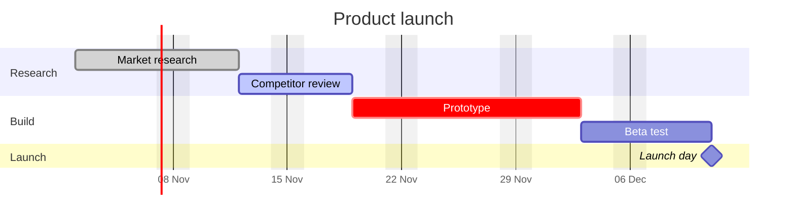

# Static Gantt Example

A Gantt chart written by hand, with no plugin at all. Obsidian renders Mermaid diagrams natively, so this block works in any vault. Use it for a one-off plan; use [[Timeline]] when the dates live in your task notes.

## How the syntax works

- `dateFormat` says how dates are written in the task lines; `axisFormat` says how they are printed on the axis.
- Each line is `name :tags, id, start, end-or-duration`. Tags are optional: `done`, `active`, `crit` and `milestone`.
- `after id` starts a task when another one ends, so you can move the first task and the rest follow.
- `excludes weekends` makes durations such as `5d` count working days only.
