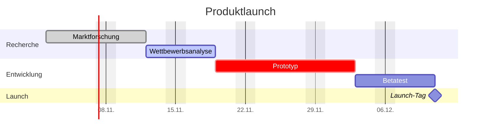

# Statisches Gantt-Beispiel

Ein von Hand geschriebenes Gantt-Diagramm, ganz ohne Plugin. Obsidian zeichnet Mermaid-Diagramme selbst, deshalb funktioniert dieser Block in jedem Vault. Nimm ihn für einen einmaligen Plan und den [[Zeitplan]], wenn die Termine in deinen Aufgabennotizen stehen.

## So funktioniert die Syntax

- `dateFormat` legt fest, wie die Daten in den Aufgabenzeilen geschrieben werden, `axisFormat`, wie sie auf der Achse erscheinen.
- Jede Zeile lautet `Name :Tags, ID, Start, Ende-oder-Dauer`. Tags sind optional: `done`, `active`, `crit` und `milestone`.
- `after id` lässt eine Aufgabe beginnen, wenn eine andere endet. Verschiebst du die erste, folgen die übrigen.
- `excludes weekends` sorgt dafür, dass Dauern wie `5d` nur Werktage zählen.
