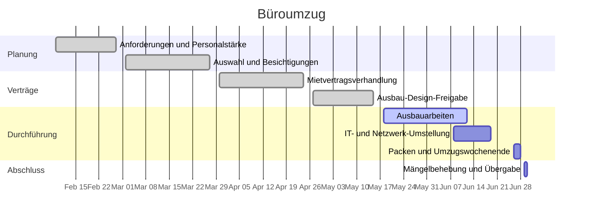

# Büroumzug

Umzug vom Büro in der Harrow Street zu Einheit 4, Dockline Park. Der aktuelle Mietvertrag endet am 2026-06-30, und das Team ist dem Raum entwachsen — keine Ruheräume, ein Besprechungsraum für alle. Ziel ist es, am Montag, 2026-06-29, von Dockline Park aus zu arbeiten, mit höchstens einem Tag Störung, und die Harrow Street am 30. sauber zu übergeben.

## Ziele

- Plätze und Schreibtische für das ganze Team plus realistisches Wachstum, ohne Hot-Desking.
- Mindestens drei buchbare Besprechungsräume und zwei Telefonboxen.
- Höchstens ein Tag Ausfallzeit: Umzug am Wochenende, IT im Voraus umgestellt.
- Die Harrow Street pünktlich zurückgeben — die Vertragsstrafe-Klausel macht Verspätung teuer.

## Meilensteine

| Meilenstein                 | Ziel       | Status      |
| --------------------------- | ---------- | ----------- |
| Anforderungen abgezeichnet  | 2026-02-27 | erledigt    |
| Standort-Auswahl und Besichtigungen | 2026-03-27 | erledigt |
| Mietvertrag unterschrieben  | 2026-04-24 | erledigt    |
| Ausbau-Design freigegeben   | 2026-05-15 | erledigt    |
| Ausbauarbeiten fertig       | 2026-06-12 | in Arbeit   |
| IT- und Netzwerk-Umstellung | 2026-06-19 | nicht begonnen |
| Umzugswochenende            | 2026-06-28 | nicht begonnen |
| Harrow Street zurückgegeben | 2026-06-30 | nicht begonnen |

## Zeitleiste

## Besprechungen

- [[2026-04-21 Lieferanten-Begehung Büroumzug]]
- [[2026-05-19 Logistik-Sync Büroumzug]]

## Risiken und Notizen

- Der Ausbau ist der kritische Pfad. Fairbank Interiors meldet eine Woche Puffer; Marcus begeht den Standort jeden Freitag.
- Die Internetleitung in Dockline Park ist für den 2026-06-15 bestätigt — verzögert sie sich, greift der IT-Umstellungsplan auf das temporäre 5G-Router-Kit zurück, das Dan im Mai getestet hat.
- Die Kistenlieferung ist für den 2026-06-22 gebucht; die Packanleitung geht am selben Tag an das Team.
