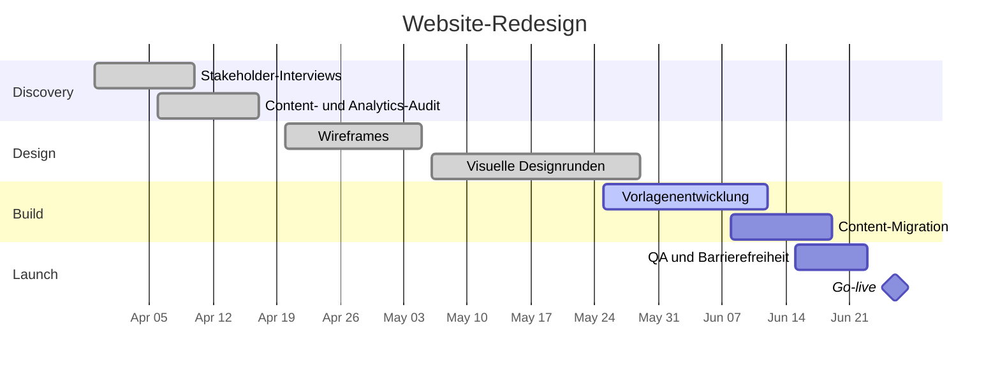

# Website-Redesign

Komplettes Redesign der Unternehmenswebsite. Die aktuelle Seite beschreibt noch die letztes Jahr eingestellte Produktlinie, schneidet auf Mobilgeräten schlecht ab, und die CMS-Vorlagen sind zu fragil, als dass das Content-Team sie sicher bearbeiten könnte. Dieses Projekt positioniert die Botschaft neu, baut die Vorlagen neu auf und schiebt im selben Aufwand einen Barrierefreiheits-Durchlauf ein.

## Ziele

- Mit den aktuellen Leistungen führen, nicht mit der alten Produktlinie.
- Das Content-Team kann jede Seite ohne Entwicklerhilfe bearbeiten.
- Eine interne Barrierefreiheits-Prüfung vor dem Launch bestehen.
- Keine Regression in der organischen Suche: Weiterleitungen für jede sich ändernde URL gemappt.

## Meilensteine

| Meilenstein                | Ziel       | Status      |
| -------------------------- | ---------- | ----------- |
| Discovery abgeschlossen    | 2026-04-17 | erledigt    |
| Wireframes freigegeben     | 2026-05-05 | erledigt    |
| Visuelles Design freigegeben | 2026-05-29 | erledigt  |
| Build und Migration fertig | 2026-06-19 | in Arbeit   |
| QA- und Barrierefreiheits-Durchlauf | 2026-06-23 | nicht begonnen |
| Launch                     | 2026-06-26 | nicht begonnen |

## Zeitleiste

## Besprechungen

- [[2026-04-02 Kickoff Website-Redesign]]
- [[2026-05-07 Designreview Website-Redesign]]

## Risiken und Notizen

- Die Content-Migration hängt davon ab, dass die Marketing-Text-Prüfung bis 2026-06-12 fertig ist; Sarah verfolgt das wöchentlich mit dem Content-Team.
- Die Weiterleitungs-Map ist der Launch-Blocker mit dem geringsten Puffer — Tom verantwortet sie, Review in die QA-Woche gelegt.
- Die Foto-Auffrischung wurde am 2026-05-07 aus dem Umfang gestrichen (siehe die Designreview-Notiz) und für ein Folgeprojekt geparkt.
