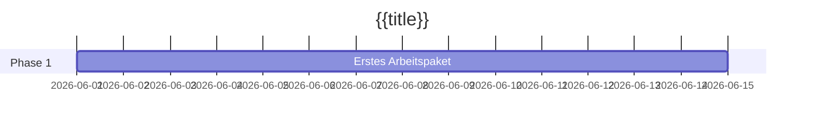

# {{title}}

Zwei oder drei Sätze: was dieses Projekt liefert, warum jetzt, und wie "fertig" aussieht. Halte die Frontmatter-Felder gefüllt — das [[Dashboard]] liest sie.

## Ziele

- Ergebnis, das das Projekt erreichen muss, so formuliert, dass du es überprüfen kannst.
- Ein zweites Ziel, falls es eines gibt. Drei sind meist genug.

## Meilensteine

| Meilenstein | Ziel | Status |
| ----------- | ---- | ------ |
|             |      | nicht begonnen |

## Zeitleiste

## Besprechungen

- Verknüpfe hier jede Besprechungsnotiz, sobald sie stattfindet.

## Risiken und Notizen

- Alles, was den Fälligkeitstermin gefährdet, mit einem Verantwortlichen daneben.
