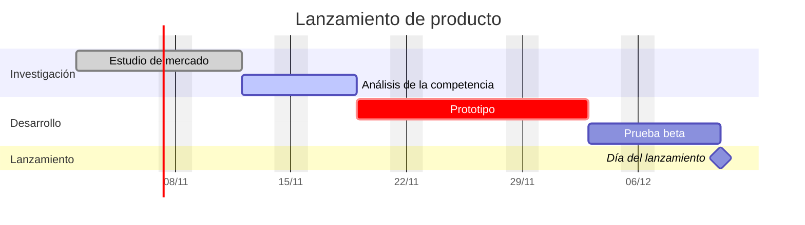

# Ejemplo de Gantt estático

Un diagrama de Gantt escrito a mano, sin ningún plugin. Obsidian dibuja los diagramas Mermaid por sí solo, así que este bloque funciona en cualquier vault. Úsalo para un plan puntual, y [[Cronograma]] cuando las fechas vivan en tus notas de tarea.

## Cómo funciona la sintaxis

- `dateFormat` indica cómo se escriben las fechas en las líneas de tarea y `axisFormat`, cómo se imprimen en el eje.
- Cada línea es `nombre :etiquetas, id, inicio, fin-o-duración`. Las etiquetas son opcionales: `done`, `active`, `crit` y `milestone`.
- `after id` hace que una tarea empiece cuando termina otra, así que si mueves la primera las demás la siguen.
- `excludes weekends` hace que duraciones como `5d` cuenten solo días laborables.
