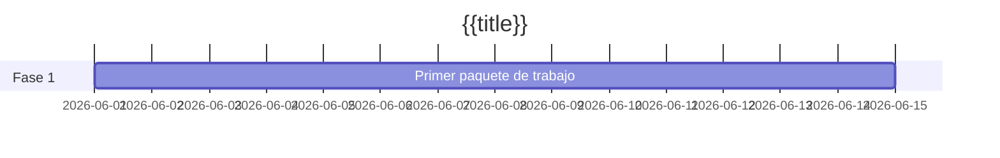

# {{title}}

Dos o tres frases: qué entrega este proyecto, por qué ahora y cómo se ve "hecho". Mantén los campos del frontmatter rellenos — el [[Panel]] los lee.

## Objetivos

- Resultado que el proyecto debe lograr, formulado para que puedas verificarlo.
- Un segundo objetivo si lo hay. Tres suele ser de sobra.

## Hitos

| Hito | Objetivo | Estado |
| ---- | -------- | ------ |
|      |          | sin empezar |

## Línea de tiempo

## Reuniones

- Enlaza aquí cada nota de reunión según ocurra.

## Riesgos y notas

- Cualquier cosa que amenace la fecha de vencimiento, con un responsable al lado.
