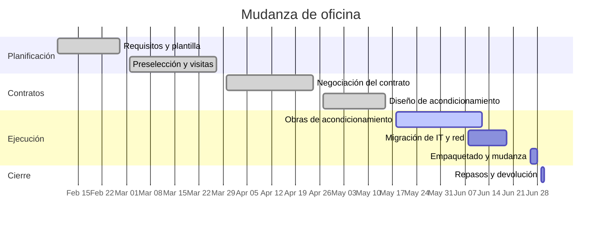

# Mudanza de oficina

Traslado de la oficina de Harrow Street a la Unidad 4, Dockline Park. El contrato actual termina el 2026-06-30 y el equipo se ha quedado sin espacio — sin salas tranquilas, una sola sala de reuniones para todos. El objetivo es estar trabajando desde Dockline Park el lunes 2026-06-29 con un día de interrupción como mucho, y devolver Harrow Street limpia el día 30.

## Objetivos

- Sitios y mesas para todo el equipo más un crecimiento realista, sin escritorios compartidos.
- Al menos tres salas de reuniones reservables y dos cabinas de teléfono.
- Un día de inactividad máximo: mudanza en fin de semana, IT migrado por adelantado.
- Devolver Harrow Street a tiempo — la cláusula de penalización del contrato hace que el retraso salga caro.

## Hitos

| Hito                        | Objetivo   | Estado      |
| --------------------------- | ---------- | ----------- |
| Requisitos firmados         | 2026-02-27 | hecho       |
| Preselección de sitios y visitas | 2026-03-27 | hecho   |
| Contrato firmado            | 2026-04-24 | hecho       |
| Diseño de acondicionamiento aprobado | 2026-05-15 | hecho |
| Obras de acondicionamiento  | 2026-06-12 | en curso    |
| Migración de IT y red       | 2026-06-19 | sin empezar |
| Fin de semana de mudanza    | 2026-06-28 | sin empezar |
| Harrow Street devuelta      | 2026-06-30 | sin empezar |

## Línea de tiempo

## Reuniones

- [[2026-04-21 Visita de proveedor de la mudanza de oficina]]
- [[2026-05-19 Sincronización logística de la mudanza de oficina]]

## Riesgos y notas

- El acondicionamiento es el camino crítico. Fairbank Interiors informa de una semana de margen restante; Marcus recorre el sitio cada viernes.
- La instalación de la línea de internet en Dockline Park está confirmada para el 2026-06-15 — si se retrasa, el plan de migración de IT recurre al kit de router 5G temporal que Dan probó en mayo.
- La entrega de cajas está reservada para el 2026-06-22; la guía de empaquetado sale para el equipo el mismo día.
