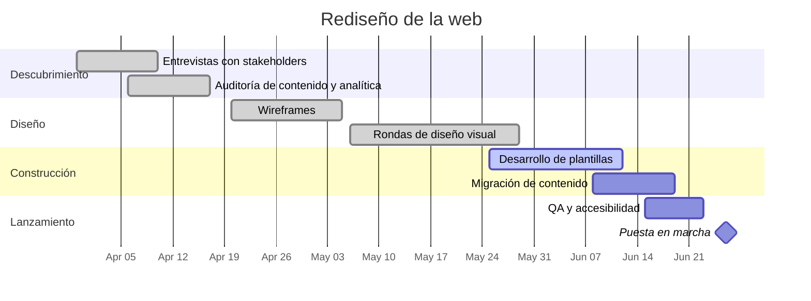

# Rediseño de la web

Rediseño completo de la web de la empresa. El sitio actual sigue describiendo la línea de producto que retiramos el año pasado, puntúa mal en móvil y las plantillas del CMS son demasiado frágiles para que el equipo de contenidos las edite con seguridad. Este proyecto reposiciona el mensaje, reconstruye las plantillas y mete una pasada de accesibilidad en el mismo esfuerzo.

## Objetivos

- Encabezar con los servicios actuales, no con la línea de producto heredada.
- Que el equipo de contenidos pueda editar cada página sin ayuda de desarrollo.
- Pasar una revisión de accesibilidad interna antes del lanzamiento.
- Sin regresión en búsqueda orgánica: redirecciones mapeadas para cada URL que cambie.

## Hitos

| Hito                       | Objetivo   | Estado      |
| -------------------------- | ---------- | ----------- |
| Descubrimiento completado  | 2026-04-17 | hecho       |
| Wireframes aprobados       | 2026-05-05 | hecho       |
| Diseño visual aprobado     | 2026-05-29 | hecho       |
| Construcción y migración   | 2026-06-19 | en curso    |
| Pasada de QA y accesibilidad | 2026-06-23 | sin empezar |
| Lanzamiento                | 2026-06-26 | sin empezar |

## Línea de tiempo

## Reuniones

- [[2026-04-02 Arranque del rediseño de la web]]
- [[2026-05-07 Revisión de diseño del rediseño de la web]]

## Riesgos y notas

- La migración de contenido depende de que la revisión del texto de marketing termine antes del 2026-06-12; Sarah lo sigue con el equipo de contenidos cada semana.
- El mapa de redirecciones es el bloqueante de lanzamiento con menos holgura — Tom lo lleva, revisión reservada para la semana de QA.
- La renovación de fotografía se sacó del alcance el 2026-05-07 (ver la nota de revisión de diseño) y se aparcó para un proyecto posterior.
