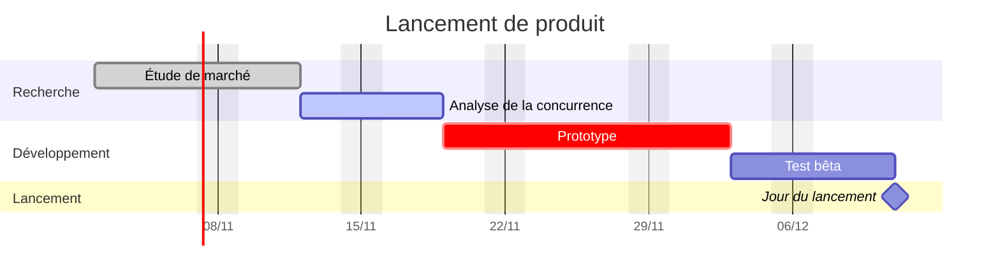

# Exemple de Gantt statique

Un diagramme de Gantt écrit à la main, sans aucun plugin. Obsidian dessine lui-même les diagrammes Mermaid, ce bloc fonctionne donc dans n'importe quel vault. Utilisez-le pour un plan ponctuel, et le [[Calendrier]] quand les dates vivent dans vos notes de tâche.

## Comment fonctionne la syntaxe

- `dateFormat` indique comment les dates sont écrites dans les lignes de tâche, `axisFormat` comment elles s'affichent sur l'axe.
- Chaque ligne s'écrit `nom :étiquettes, id, début, fin-ou-durée`. Les étiquettes sont facultatives : `done`, `active`, `crit` et `milestone`.
- `after id` fait démarrer une tâche quand une autre se termine : si vous déplacez la première, les suivantes suivent.
- `excludes weekends` fait compter uniquement les jours ouvrés dans des durées comme `5d`.
