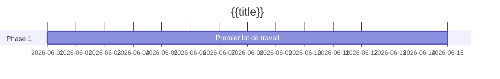

# {{title}}

Deux ou trois phrases : ce que ce projet livre, pourquoi maintenant, et à quoi ressemble « terminé ». Gardez les champs du frontmatter remplis — le [[Tableau de bord]] les lit.

## Objectifs

- Résultat que le projet doit atteindre, formulé pour que vous puissiez le vérifier.
- Un deuxième objectif s'il y en a un. Trois suffisent généralement.

## Jalons

| Jalon | Cible | Statut |
| ----- | ----- | ------ |
|       |       | non commencé |

## Chronologie

## Réunions

- Liez ici chaque note de réunion au fur et à mesure.

## Risques et notes

- Tout ce qui menace l'échéance, avec un responsable à côté.
