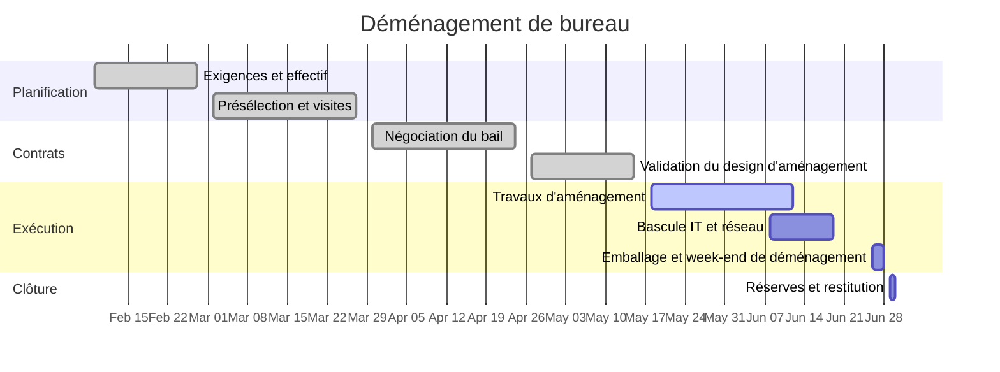

# Déménagement de bureau

Relocalisation du bureau de Harrow Street vers l'Unité 4, Dockline Park. Le bail actuel se termine le 2026-06-30 et l'équipe a dépassé l'espace — pas de salles au calme, une seule salle de réunion pour tout le monde. L'objectif est de travailler depuis Dockline Park le lundi 2026-06-29 avec au plus un jour de perturbation, et de rendre Harrow Street propre le 30.

## Objectifs

- Des places et des bureaux pour toute l'équipe plus une croissance réaliste, sans bureaux partagés.
- Au moins trois salles de réunion réservables et deux cabines téléphoniques.
- Un jour d'arrêt maximum : déménagement le week-end, bascule IT à l'avance.
- Rendre Harrow Street à temps — la clause de pénalité du bail rend tout retard coûteux.

## Jalons

| Jalon                       | Cible      | Statut      |
| --------------------------- | ---------- | ----------- |
| Exigences validées          | 2026-02-27 | terminé     |
| Présélection de sites et visites | 2026-03-27 | terminé |
| Bail signé                  | 2026-04-24 | terminé     |
| Design d'aménagement validé | 2026-05-15 | terminé     |
| Travaux d'aménagement faits | 2026-06-12 | en cours    |
| Bascule IT et réseau        | 2026-06-19 | non commencé |
| Week-end de déménagement    | 2026-06-28 | non commencé |
| Harrow Street rendue        | 2026-06-30 | non commencé |

## Chronologie

## Réunions

- [[2026-04-21 Visite fournisseur du déménagement de bureau]]
- [[2026-05-19 Synchro logistique du déménagement de bureau]]

## Risques et notes

- L'aménagement est le chemin critique. Fairbank Interiors signale une semaine de marge restante ; Marcus parcourt le site chaque vendredi.
- L'installation de la ligne internet à Dockline Park est confirmée pour le 2026-06-15 — si elle glisse, le plan de bascule IT se rabat sur le kit routeur 5G temporaire que Dan a testé en mai.
- La livraison des caisses est réservée pour le 2026-06-22 ; le guide d'emballage part vers l'équipe le même jour.
