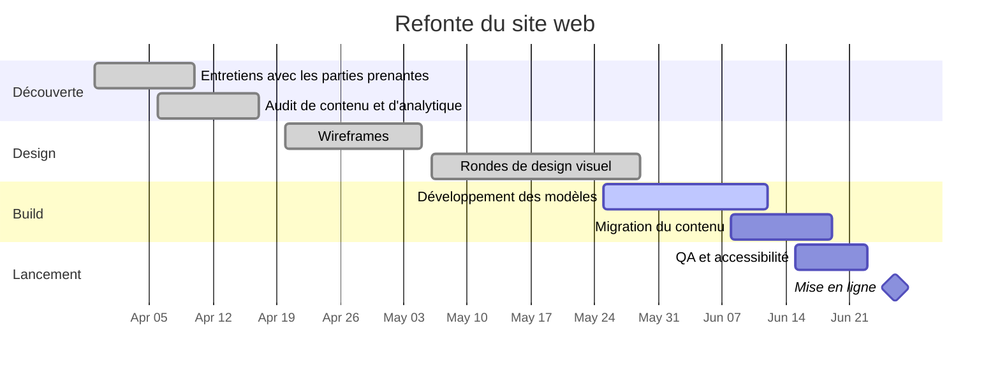

# Refonte du site web

Refonte complète du site web de l'entreprise. Le site actuel décrit encore la gamme de produits que nous avons retirée l'an dernier, obtient de mauvais scores sur mobile, et les modèles du CMS sont trop fragiles pour que l'équipe de contenu les édite sans risque. Ce projet repositionne le message, reconstruit les modèles et intègre une passe d'accessibilité dans le même effort.

## Objectifs

- Mettre en avant les services actuels, pas l'ancienne gamme de produits.
- L'équipe de contenu peut éditer chaque page sans aide d'un développeur.
- Réussir une revue d'accessibilité interne avant le lancement.
- Aucune régression en recherche organique : redirections cartographiées pour chaque URL qui change.

## Jalons

| Jalon                      | Cible      | Statut      |
| -------------------------- | ---------- | ----------- |
| Découverte terminée        | 2026-04-17 | terminé     |
| Wireframes approuvés       | 2026-05-05 | terminé     |
| Design visuel approuvé     | 2026-05-29 | terminé     |
| Build et migration faits   | 2026-06-19 | en cours    |
| Passe QA et accessibilité  | 2026-06-23 | non commencé |
| Lancement                  | 2026-06-26 | non commencé |

## Chronologie

## Réunions

- [[2026-04-02 Lancement de la refonte du site web]]
- [[2026-05-07 Revue de design de la refonte du site web]]

## Risques et notes

- La migration du contenu dépend de l'achèvement de la relecture du texte marketing avant le 2026-06-12 ; Sarah le suit chaque semaine avec l'équipe de contenu.
- La carte des redirections est le bloqueur de lancement avec le moins de marge — Tom en est responsable, revue calée dans la semaine de QA.
- Le rafraîchissement photo a été retiré du périmètre le 2026-05-07 (voir la note de revue de design) et garé pour un projet ultérieur.
