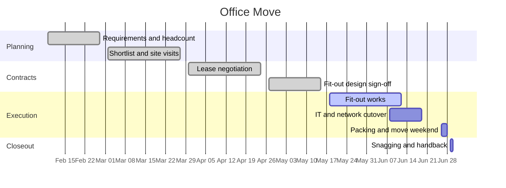

# Office Move

Relocation from the Harrow Street office to Unit 4, Dockline Park. The current lease ends 2026-06-30 and the team has outgrown the space — no quiet rooms, one meeting room for everyone. Goal is to be working from Dockline Park on Monday 2026-06-29 with at most one day of disruption, and to hand Harrow Street back clean on the 30th.

## Objectives

- Seats and desks for the whole team plus realistic growth, without hot-desking.
- At least three bookable meeting rooms and two phone booths.
- One day of downtime maximum: move over the weekend, IT cut over in advance.
- Hand back Harrow Street on time — the lease penalty clause makes lateness expensive.

## Milestones

| Milestone                   | Target     | Status      |
| --------------------------- | ---------- | ----------- |
| Requirements signed off     | 2026-02-27 | done        |
| Site shortlist and visits   | 2026-03-27 | done        |
| Lease signed                | 2026-04-24 | done        |
| Fit-out design sign-off     | 2026-05-15 | done        |
| Fit-out works complete      | 2026-06-12 | in progress |
| IT and network cutover      | 2026-06-19 | not started |
| Move weekend                | 2026-06-28 | not started |
| Harrow Street handed back   | 2026-06-30 | not started |

## Timeline

## Meetings

- [[2026-04-21 Office Move Vendor Walkthrough]]
- [[2026-05-19 Office Move Logistics Sync]]

## Risks and notes

- Fit-out is the critical path. Fairbank Interiors report one week of float left; Marcus walks the site every Friday.
- Internet line install at Dockline Park is confirmed for 2026-06-15 — if it slips, the IT cutover plan falls back to the temporary 5G router kit Dan tested in May.
- Crate delivery booked for 2026-06-22; packing guide goes out to the team the same day.
