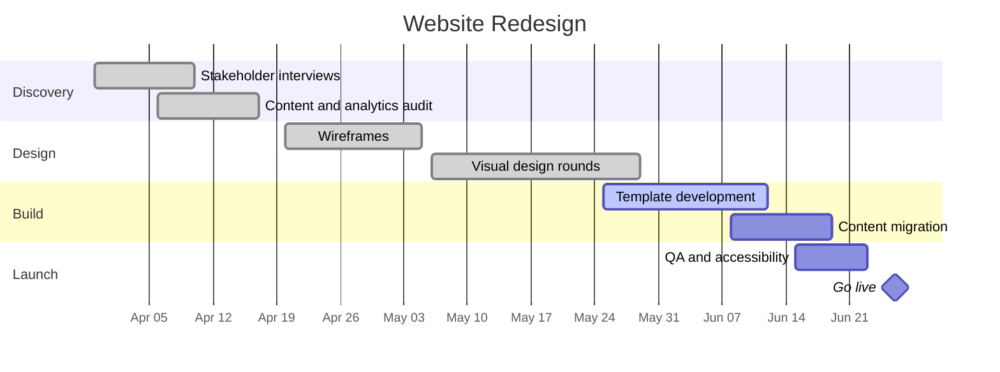

# Website Redesign

Full redesign of the company website. The current site still describes the product line we retired last year, scores poorly on mobile, and the CMS templates are too brittle for the content team to edit safely. This project repositions the messaging, rebuilds the templates, and ships an accessibility pass in the same effort.

## Objectives

- Lead with the current services, not the legacy product line.
- Content team can edit every page without developer help.
- Pass an internal accessibility review before launch.
- No regression in organic search: redirects mapped for every URL that changes.

## Milestones

| Milestone                  | Target     | Status      |
| -------------------------- | ---------- | ----------- |
| Discovery complete         | 2026-04-17 | done        |
| Wireframes approved        | 2026-05-05 | done        |
| Visual design approved     | 2026-05-29 | done        |
| Build and migration done   | 2026-06-19 | in progress |
| QA and accessibility pass  | 2026-06-23 | not started |
| Launch                     | 2026-06-26 | not started |

## Timeline

## Meetings

- [[2026-04-02 Website Redesign Kickoff]]
- [[2026-05-07 Website Redesign Design Review]]

## Risks and notes

- Content migration depends on the marketing copy review finishing by 2026-06-12; Sarah is tracking this with the content team weekly.
- The redirect map is the launch blocker with the least slack — Tom owns it, review booked into QA week.
- Photography refresh was cut from scope on 2026-05-07 (see the design review note) and parked for a follow-up project.
