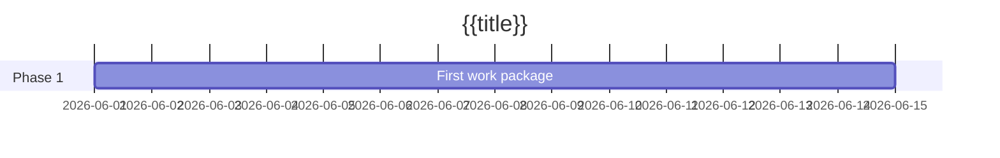

# {{title}}

Two or three sentences: what this project delivers, why now, and what "done" looks like. Keep the frontmatter fields filled — the [[Dashboard]] reads them.

## Objectives

- Outcome the project must achieve, phrased so you can verify it.
- A second objective if there is one. Three is usually plenty.

## Milestones

| Milestone | Target | Status |
| --------- | ------ | ------ |
|           |        | not started |

## Timeline

## Meetings

- Link each meeting note here as it happens.

## Risks and notes

- Anything that threatens the due date, with an owner next to it.
